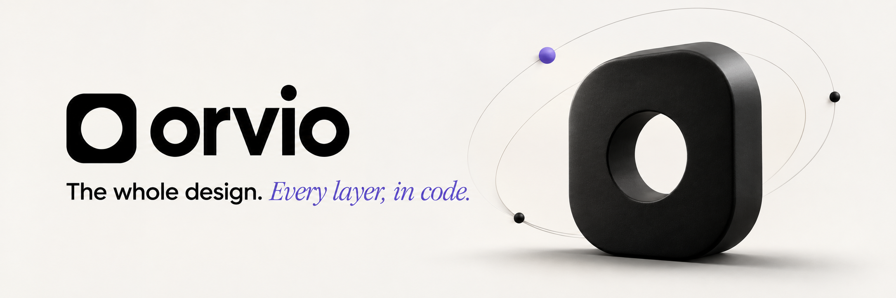

<p align="center">
  <a href="https://orvio.design"></a>
</p>

<h3 align="center">Studio-grade websites, web apps and mobile apps. Full source, ready to build on.</h3>

<p align="center">
  <a href="https://orvio.design/catalog">Explore the catalog</a> ·
  <a href="https://orvio.design/agent-mcp">MCP & CLI</a> ·
  <a href="https://orvio.design/docs">Documentation</a> ·
  <a href="https://orvio.design/membership">Membership</a> ·
  <a href="https://orvio.design/support">Support</a>
</p>

---

**Orvio** is a library of complete, art-directed design products for designers, developers and studios. Each product brings its own brand, design tokens, pages or screens, and source files. One membership gives you access to the whole catalog.

Preview products free on desktop, tablet and phone. Start from a complete design, take a page or component, or use its visual direction as inspiration for your own project.

### What you get

- **Websites, web apps and mobile apps** with complete pages, screens and flows.
- **A distinct identity per product:** logo, colours, typography, imagery and voice.
- **HTML source**, with CSS and JavaScript, ready for your project or for your agent to adapt to your framework.
- **Readable design tokens** for colours, type and spacing.
- **Human-reviewed releases**, available through ZIP, CLI and Agent MCP.

### Build your way

| Access | How it works |
|---|---|
| **Agent MCP** | Connect your AI tool, authorize in your browser, then request products, pages, components or tokens. Tested with Claude and Codex. |
| **CLI** | Install from npm, sign in, and pull a product into your project. |
| **ZIP** | Download the complete source from a product page. |

**Remote MCP server**

```text
https://mcp.orvio.design/mcp
```

The server exposes nine read-only tools to search the catalog, inspect releases, fetch source files, pages and components, read tokens, and retrieve bookmarks. Access uses browser authorization and an active membership.

[Connection guide](https://orvio.design/agent-mcp) · [Tools reference](https://orvio.design/docs/mcp/tools)

**Command line**

```sh
npm install -g orvio
orvio login
orvio pull YOUR_PRODUCT_SLUG
```

Requires Node.js 20 or later. Replace `YOUR_PRODUCT_SLUG` with the identifier from the catalog.

[CLI documentation](https://orvio.design/docs/cli/install) · [npm package](https://www.npmjs.com/package/orvio)

### Start with the docs

[Quickstart](https://orvio.design/docs/getting-started/quickstart) · [Prompt library](https://orvio.design/docs/prompts)

Use a design as a complete starting point, take inspiration from its visual system, or ask your agent to rebuild it in your framework. The prompt library covers pages, components, tokens and framework adaptation.

### Membership and licensing

Membership unlocks source downloads and agent access across the catalog. Projects started during an active membership stay licensed after cancellation. See the [Orvio licence](https://orvio.design/license) for the full terms.

<sub>Product source repositories are private. Get licensed access through <a href="https://orvio.design">orvio.design</a>.</sub>
