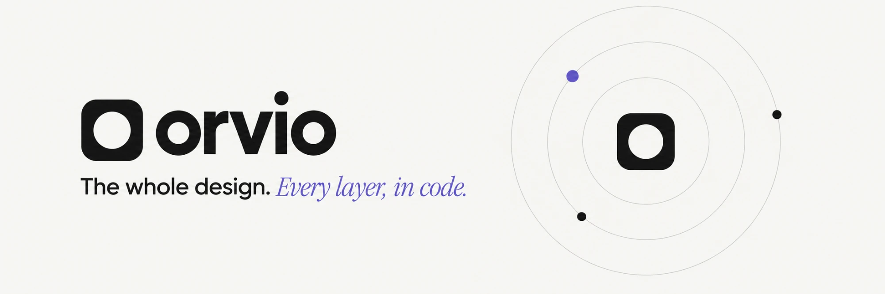

  

<h3 align="center">Complete, coded design products with their full source, by download or through your AI agent.</h3>

  <a href="https://orvio.design">Website</a> ·
  <a href="https://orvio.design/catalog">Catalog</a> ·
  <a href="https://orvio.design/docs">Documentation</a> ·
  <a href="https://www.npmjs.com/package/orvio">CLI on npm</a> ·
  <a href="https://orvio.design/support">Support</a>

---

**Orvio** is a members' library of independent, versioned design products: websites and mobile apps delivered as real source (HTML, CSS and JavaScript, with their design tokens), not screenshots or a component kit. One membership opens the whole catalog.

### Take a product three ways

| | How | Start |
|---|---|---|
| **Your AI tool** | Connect the Orvio MCP server to Claude, Cursor, ChatGPT or Windsurf, then ask for a product, a page, a component or its tokens. | `https://mcp.orvio.design/mcp` · [guide](https://orvio.design/docs/mcp/connect-claude) |
| **The command line** | Sign in once, then pull the current release into your project. | `npx orvio pull <product>` · [guide](https://orvio.design/docs/cli/install) |
| **Download** | The release as a ZIP, from the product's page. | [catalog](https://orvio.design/catalog) |

### In the catalog

- **[Sotto](https://orvio.design/products/sotto)** · website · a calm site for a scout-led remote recruitment service
- **[Brume](https://orvio.design/products/brume)** · mobile app · a mental health app with a cloud companion and a daily inner-weather check-in

Every release is validated, reviewed by a person and versioned; you get the newest one, and your agent can port it to React, Vue or anything else.

### Listed on

The [MCP Registry](https://registry.modelcontextprotocol.io) as `design.orvio/orvio` · [npm](https://www.npmjs.com/package/orvio) as `orvio` (MIT)

The product repositories in this organization are private: their source is for members, under the [Orvio licence](https://orvio.design/license).
